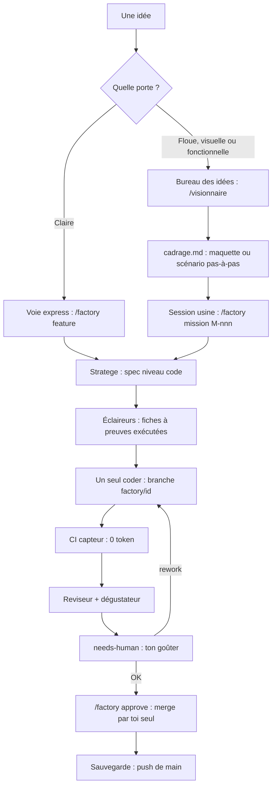

# 🏭 Software Factory

> **L'usine à software qui vit dans Vibe Desktop.** L'IA éclaire, spécifie, code, teste et révise. Toi, tu cadrés, tu goûtes, et rien n'entre dans `main` sans toi.

Le principe en une phrase : tu clones cette usine dans ton dossier projet, tu ouvres une session Vibe Desktop (onglet Code) dans ce dossier, et l'usine y développe des features de bout en bout, jusqu'à un merge que **toi seul** valides.

---

## 📑 Sommaire

1. [L'idée en une minute](#-lidée-en-une-minute)
2. [Installation](#-installation)
3. [Sauvegarde](#-sauvegarde)
4. [Le quotidien : tes sessions](#-le-quotidien--tes-sessions)
5. [La boucle de production](#-la-boucle-de-production)
6. [Commandes](#-commandes)
7. [Les FORMES](#-les-formes)
8. [La doctrine](#-la-doctrine)
9. [Tips de terrain](#-tips-de-terrain)
10. [Structure des fichiers](#-structure-des-fichiers)
11. [Suivre l'usine en direct](#-suivre-lusine-en-direct)
12. [Historique des versions](#-historique-des-versions)

---

## 🎯 L'idée en une minute

Une usine, ça ne improvise pas : ça suit un plan. Ici, le plan tient en trois idées.

**Un menu fermé.** L'usine ne fabrique que ce qu'elle SAIT fabriquer : des FORMES (script Python, app web React, app de bureau Tauri…). Une demande hors menu remonte vers toi, elle n'est jamais improvisée.

**Une chaîne, pas un artiste.** Chaque feature passe par les mêmes stations : éclaireurs (preuves), spec, UN coder, CI capteur, revues, dégustation. Puis le goûter humain, puis le merge. Le désordre parallèle a déjà coûté une mission entière : ici, un seul chantier à la fois.

**La connaissance vit dans des fichiers.** Specs, fiches, cadrages, contexte, journal : tout ce que l'usine apprend est écrit dans le repo, jamais dans une conversation perdue.



## 📦 Installation

**Prérequis**

- **Git**, installé et visible depuis la session Vibe (l'usine vérifie `git status` avant tout code : pas de git, pas de job).
- **Vibe Desktop** (onglet Code). Sur Windows, PowerShell 5+ pour le script d'installation.
- Python, optionnel (le dashboard de suivi et la forme `script-python`).

**Nouveau projet** (le clone devient ton logiciel) :

```powershell
git clone https://github.com/Mar2684/software-factory.git MonProjet
cd MonProjet
.\install.ps1 -Mode New
```

**Projet existant** (l'usine vient en renfort, ton repo reste le tien) : cloner ce pattern à côté, puis depuis le dossier du projet :

```powershell
..\software-factory\install.ps1 -Mode Existing
```

**Après l'installation**

- Ouvre une session Code Vibe Desktop dans le dossier du projet. Le dossier est proposé comme trusted : accepte.
- Vérifie que `/skills` liste `factory`.
- Si PowerShell bloque les scripts :
  `powershell -ExecutionPolicy Bypass -File .\install.ps1 -Mode New`

## 💾 Sauvegarde

L'usine se sauvegarde elle-même : `/factory approve` pousse `main` vers le remote du projet après le merge. Sans remote, l'usine continue en local (le mémo de l'approve t'affiche la commande) ; un push en échec (auth, réseau) n'est JAMAIS bloquant, il repasse au merge suivant.

Un projet né via `-Mode New` démarre **sans remote** : l'installation détache volontairement l'origine du pattern, ton code ne poussera jamais vers ce repo public. Lie ton projet une seule fois à SON propre repo, depuis le dossier du projet :

```powershell
gh repo create MonProjet --private --source . --remote origin --push
```

(ou, repo déjà créé : `git remote add origin https://github.com/<compte>/MonProjet.git` puis `git push -u origin main`)

Un projet existant (`-Mode Existing`) a déjà son remote : rien à lier.

## 🧭 Le quotidien : tes sessions

Deux sortes de sessions, jamais mélangées. C'est le montage validé sur le terrain (v1.3.5).

| Session | Modèle recommandé | Ce qui s'y passe |
|---|---|---|
| 🏭 **L'usine** (permanente) | fort (Mistral Large 4) | Une session Code locale sur le projet, jamais fermée. Tous les `/factory` y vivent : `next`, `journal`, `approve`, merge inclus. C'est le fil conducteur de tout le travail. |
| 💡 **Le bureau des idées** (courtes) | éco au choix (Mistral Small 4, GLM 5.3 Flash) | Une idée = une petite session. Tu y lances `/visionnaire`, la discussion produit une maquette ou un scénario, jusqu'au « cadré ». Puis la session se range : fiche archivée par mission. |

**Le pont entre les deux** : le cadrage aboutit dans `factory/missions/<id>/cadrage.md`, puis la production repart dans la session usine avec `/factory mission M-nnn`. Les questions créatives ne contaminent jamais la chaîne, et l'usine ne rate rien : tout passe par le fichier.

**Pourquoi ces modèles là** : la session usine porte la qualité (spec, code, revues), économise plutôt sur les rounds ratés que sur les tokens. La session du visionnaire est jetable et isolée : c'est l'endroit idéal pour tester les modèles éco sans rien risquer. Le critère du canari : si la maquette te charme toujours, l'éco est validé.

## 🔁 La boucle de production

À l'intérieur de la session usine, chaque job traverse les mêmes stations :

| Station | Rôle |
|---|---|
| **Orchestrateur** | La session usine elle-même. Seul rédacteur du board, tient le journal, ouvre les portes. |
| **Stratege** | Écrit le spec niveau code, avec la section intention du cadrage et les écarts justifiés. |
| **Éclaireurs** | Explorent les briques inconnues et produisent des fiches à PREUVES EXÉCUTÉES. Depuis v1.3.6, ils peuvent installer l'outillage manquant : annoncé, approuvé, fiché. |
| **Coder** | UN seul coder. Une branche `factory/<id>`, un fichier `build.md` comme journal du chantier. |
| **CI capteur** | Déterministe, 0 token : CI de la forme + tests du logiciel (régression). « Ran 0 tests » = échec. |
| **Reviseur** | Relit le spec contre le livrable ET le cadrage : un écart non justifié = CHANGES. |
| **Dégustateur** | Goûte le livrable en l'exécutant pour de vrai. |
| **Vigie** | Verdict CONTINUE/ESCALADE quand ça stagne. |
| **Hotline goût** | `visionnaire-consult`, consultable UNE fois par round sur une question de direction : une direction, 30 lignes max. |

La chaîne s'arrête toujours à `needs-human` : le dossier de mission t'attend avec le handover, tu goûtes, puis `rework` ou `approve`. Le merge est à toi, personne d'autre ne l'a le droit.

**La carte éco** (v1.3.4) : reviseur, dégustateur et resumer tournent sur un petit modèle (Mistral Small 4) via les TOML. La preuve que la carte est branchée vit dans le journal : champ `model` rempli avec le modèle réel, plus de « session-default ». Si une station éco rate la qualité, on remonte UNE station au fort à la fois.

## ⌨️ Commandes

| Commande | Où | Effet |
|---|---|---|
| `/factory <feature>` | usine | Job express : classe la forme, éclaire l'inconnu, spec, code, CI, revues → needs-human |
| `/factory next` | usine | Lance le premier élément non coché du backlog |
| `/factory mission M-nnn` | usine | Lance la production d'une mission cadrée au bureau des idées |
| `/factory context` | usine | (Re)dresse la carte du logiciel pour les agents (`factory/contexte/`) |
| `/factory approve <job-id>` | usine | Nettoie le chantier, merge `--no-ff` (toi seul), CI post-merge, README + contexte, sauvegarde (push main) |
| `/factory rework <job-id> <note>` | usine | Renvoie un job needs-human au coder avec ta note |
| `/factory journal` | usine | Le rapport par station depuis le journal (verdicts, modèles, coûts) |
| `/visionnaire` | bureau des idées | Charge le visionnaire : discussion adaptative, maquette ou scénario, jusqu'au « cadré » |

## 🍰 Les FORMES

Le menu est **fermé** : rien n'entre ACTIF sans une mission de validation réussie de bout en bout. Une ébauche ne reçoit pas de mission avant ses fiches d'éclaireurs.

| Forme | Statut | Validation |
|---|---|---|
| `script-python` | ✅ ACTIVE | pong + carnet de dépenses CLI |
| `web-react` | ✅ ACTIVE | board d'usine (React, Vite, Vitest, 75 tests) |
| `app-pc-tauri` | 🔶 ébauche | mission 008 en préparation (fenêtre native autour du board) |
| `android-apk` | 🔶 ébauche | aucune mission avant fiches gradle/SDK |

Faire évoluer le menu (nouvelle forme, nouvelle ligne CI) est un **geste d'atelier** : tu l'écris à la main dans `factory/formes/menu.md`, la boucle n'y touche jamais.

## 🧱 La doctrine

1. **Le menu est fermé.** Une feature = une forme du menu, sinon escalade vers toi. La génération libre de structure a échoué, l'instanciation du connu réussit.
2. **Mono-chantier.** Un coder, une branche, jamais de code parallèle. La couture entre chantiers est le risque n°1.
3. **Le capteur avant le cerveau.** CI déterministe avant toute revue ; une CI muette fabrique des faux PASS.
4. **La connaissance vit dans des fichiers.** Spec, fiche, contexte, cadrage, journal, jamais dans les conversations.
5. **Trois périmètres étanches.** LE LOGICIEL à la racine ; l'USINE dans `.vibe/` et `factory/` ; les ESSAIS dans `factory/fiches/essais/`, gitignorés et détruits au nettoyage.
6. **Le chantier se nettoie avant chaque merge.** Tout chemin créé hors périmètre est un déchet : il disparaît. `workspace/` est interdit.
7. **Deux README, un par périmètre.** La boucle n'écrit que le README racine (logiciel) ; `factory/README.md` (usine) est intouchable.
8. **Le cadrage avant le spec.** Les libertés créatives se prennent en mission, jamais en build.
9. **Aucun secret vu des agents, aucun merge automatique.** L'humain goûte, l'humain merge.
10. **L'usine se sauvegarde.** Chaque approve pousse `main` vers ton remote.

## 💡 Tips de terrain

Chaque tip ci-dessous a été payé par un vrai incident. Ils valent de l'argent.

- **Arbre propre avant `/factory next`.** Toute modification faite hors boucle (backlog, config) se committe d'abord, sinon l'usine refuse de partir.
- **Le backlog ne contient QUE des features du logiciel.** Jamais l'outillage de l'usine : software et usine restent indépendants.
- **« Ran 0 tests » = échec.** Même avec exit 0. Le capteur exige une CI auto-descriptive qui prouve ce qu'elle a joué.
- **Une maquette se traduit en silence.** Au cadrage, numérote les « Éléments à ne pas perdre » ; le spec doit tracer chaque élément ou justifier son écart dans « Écarts vs cadrage », jusqu'au handover.
- **La preuve s'adapte au sujet.** Maquette HTML pour une direction visuelle, scénario pas-à-pas pour une direction fonctionnelle. Un livrable créatif qui se raconte au lieu de se montrer n'est pas goûtable.
- **L'éclaireur outilleur : ANNONCÉ, APPROUVÉ, FICHÉ.** Une ligne par outil avant le premier essai, la fenêtre d'approbation de la session comme porte humaine (jamais de flag silencieux, un refus = escalade sans insister), fiche outillage avec commandes, versions, emplacements.
- **Hotline : une seule par round.** Plus d'une consultation du visionnaire-consult = escalade : le cadrage doit suffire.
- **Fiches à preuves exécutées.** Une doc sans sortie réelle est de la prose interdite : le coder obéirait et confabulerait.
- **Un serveur `http.server` oublié verrouille les suppressions.** Processus sans fenêtre, ancré dans le dossier, Windows refuse de supprimer. Coupe-le avant de nettoyer un chantier.
- **Les dossiers lourds se suppriment en local.** Une grosse suppression pilotée à distance peut geler la machine plusieurs minutes : PowerShell local d'abord.
- **`git remote -v` tôt dans la vie d'un projet.** Le mode New détache volontairement l'origine du pattern ; lie ton repo une fois, puis l'usine s'autode sauvegarde à chaque approve.
- **Le journal est un capteur, pas un carnet.** Champ `model` rempli = preuve que la carte éco tourne ; si tu y lis « session-default », elle n'est pas branchée.
- **Les sessions ne se mélangent jamais.** Cadrage d'un côté, production de l'autre ; le pont, c'est le fichier `cadrage.md`.
- **Les évolutions de l'usine sont un geste d'atelier.** Menu des formes, skills, prompts : tu les modifies à la main, la boucle n'y touche pas.

## 🗂️ Structure des fichiers

```
MonProjet/
├─ README.md              # doc du LOGICIEL (toi + la boucle à l'approve)
├─ src/ …                 # ton logiciel
├─ install.ps1            # l'installateur de l'usine
├─ .vibe/
│  ├─ skills/factory/     # le skill orchestrateur (/factory)
│  ├─ skills/visionnaire/ # le skill du bureau des idées (/visionnaire)
│  ├─ agents/             # subagents (stratege, coder, vigie, visionnaire-consult…)
│  └─ prompts/            # les prompts des stations
└─ factory/
   ├─ README.md           # doc de l'USINE (ce fichier-ci, intouchable par la boucle)
   ├─ board.json          # l'état : un job n'y disparaît JAMAIS
   ├─ journal.jsonl       # le journal : stations, verdicts, modèles, coûts
   ├─ backlog.md          # les features à produire
   ├─ dashboard.html      # le suivi en direct
   ├─ formes/menu.md      # le menu des FORMES (fermé, geste d'atelier)
   ├─ contexte/           # la carte du logiciel pour les agents
   ├─ fiches/             # fiches d'outils à preuves (essais/ gitignorés)
   ├─ missions/<id>/      # options, cadrages, maquettes
   └─ jobs/<id>/          # spec, build.md, revues, décision, handover
```

## 👀 Suivre l'usine en direct

```powershell
python -m http.server 8123
```

Depuis le dossier `factory/`, puis ouvre <http://localhost:8123/dashboard.html> : le board se rafraîchit toutes les 2 secondes, un job n'y disparaît jamais (stage inconnu = colonne « autre »). Si ton projet a une vitrine (par ex. le board React), elle vit sur le même port.

## 📜 Historique des versions

| Version | Date | L'essentiel |
|---|---|---|
| v0.1 | 21/11 | Git prérequis bloquant, `build.md` par job, verrou un job actif |
| v1.0 | 21/11 | Le pattern devient installable : mode software, `/factory context`, nouvelles formes |
| v1.2 | 21/11 | Correctifs install, trois périmètres étanches, nettoyage de chantier, deux README |
| v1.3 | 22/11 | Vision + mission + mesure + économie : commandes de mission, journal par station |
| v1.3.1→v1.3.3 | 22/11 | Le visionnaire devient conversationnel, adaptatif, puis la commande `/visionnaire` |
| v1.3.4 | 22/11 | Fidélité maquette (checklist « à ne pas perdre ») + carte éco complétée |
| v1.3.5 | 22/11 | Session usine permanente + hotline goût en mission |
| v1.3.6 | 22/11 | L'éclaireur outilleur : annoncé, approuvé, fiché |
| v1.3.7 | 22/11 | L'usine se sauvegarde : push automatique à l'approve |

---

> Une factory ne se répare pas dans la boucle, elle s'améliore à l'atelier. Les retours de terrain deviennent des retouches versionnées, chacune arbitrée, jamais improvisées.
